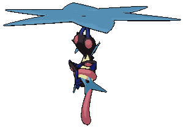
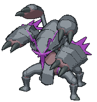
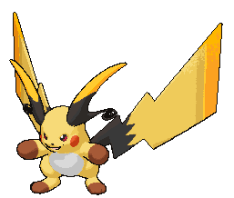
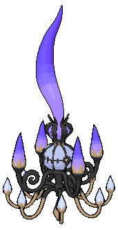

# Sprite-Drawer

Animated pixel sprites from 3D Pokémon models (palette colours, cel bands, inverted-hull lines), made
automatically from the model and the game's own idle animation.

<p>






</p>

- `sprites/<pokemon>/`: the finished GIFs (front, back, shinies, each with a 4x copy)
- `models/<pokemon>/`: one config per sprite. The models themselves are local only.
- `pipeline/`: the scripts. Each one prints its usage at the top.

Needs Blender (on `PATH`, at `SPRITE_BLENDER`, or the macOS app) and Python 3 with numpy and Pillow.
It sizes itself to the machine: one Blender per 4 GB of RAM (`SPRITE_BLENDER_SLOTS` to override).

```bash
python3 pipeline/new.py MODEL.zip ANIM.zip     # model + animation pack -> config + GIFs in out/<pokemon>/
python3 pipeline/build.py [POKEMON]            # rebuild after editing a config (all Pokémon if none named)
python3 pipeline/build.py --publish POKEMON    # copy the approved GIFs into sprites/
python3 pipeline/regress.py                    # rebuild a few and compare with sprites/; the pre-push hook runs it
```

In a fresh clone, turn the hook on with `git config core.hooksPath .githooks`.

Fan project, not affiliated with Nintendo, Game Freak or The Pokémon Company.
