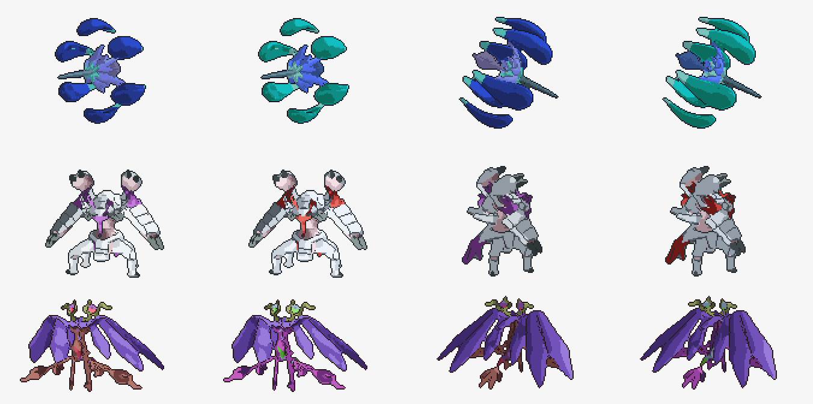

# Sprite-Drawer

Turns 3D Pokémon models into animated pixel sprites in the Pokémon Showdown (Gen 6) style.



Finished sprites are in [`final_sprites/`](final_sprites).

## Requirements

- Blender (scripts expect `/Applications/Blender.app`)
- Python 3 with `numpy` and `Pillow`
- Your own models and Showdown reference frames: they aren't included in this repo

## Usage

From `lapras-model/Lapras/`:

```bash
python3 render_parallel.py CONFIG.json frames/
python3 make_gif.py CONFIG.json frames/ out.gif --scale 4
```

Each Pokémon is one config JSON (palette, pose, camera, style). `make_gif.py` also runs the quality checks.
See [`SPRITE_PIPELINE.md`](lapras-model/Lapras/SPRITE_PIPELINE.md) for the full process.

Fan project, not affiliated with Nintendo, Game Freak or The Pokémon Company.
