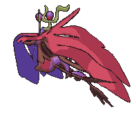
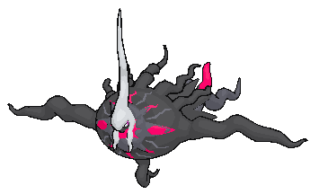
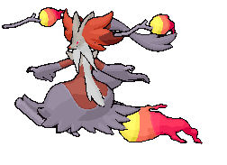
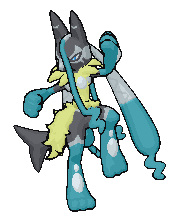
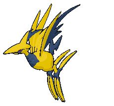

# Sprite-Drawer

Animated pixel sprites from 3D Pokémon models (palette colours, cel bands, inverted-hull lines), made
automatically from the model and the game's own idle animation.

<table align="center">
<tr>
<td align="center" width="200"><br><sub>Mega Greninja</sub></td>
<td align="center" width="200"><br><sub>Mega Dragalge</sub></td>
<td align="center" width="200"><br><sub>Mega Golisopod</sub></td>
<td align="center" width="200"><br><sub>Mega Darkrai</sub></td>
</tr>
<tr>
<td align="center" width="200"><br><sub>Mega Raichu X</sub></td>
<td align="center" width="200"><br><sub>Mega Delphox (shiny)</sub></td>
<td align="center" width="200"><br><sub>Mega Lucario Z</sub></td>
<td align="center" width="200"><br><sub>Mega Skarmory</sub></td>
</tr>
</table>

## Use

```bash
python3 pipeline/new.py MODEL.zip ANIM.zip
python3 pipeline/build.py [POKEMON]
python3 pipeline/build.py --publish POKEMON
python3 pipeline/regress.py
```

- `new.py`: model + the game's animation pack → a config and GIFs in `out/<pokemon>/`
- `build.py`: rebuild after editing a config (every Pokémon if none is named)
- `--publish`: copy the approved GIFs into `sprites/`
- `regress.py`: rebuild a few Pokémon and compare them with `sprites/`, pixel for pixel. The pre-push hook runs
  it; turn the hook on in a fresh clone with `git config core.hooksPath .githooks`.

## Layout

- `sprites/<pokemon>/`: the finished GIFs (front, back, shinies, each with a 4x copy)
- `models/<pokemon>/`: one config per sprite. The models themselves are local only.
- `pipeline/`: the scripts. Each one prints its usage at the top. Blender poses the model (`bake.py`);
  `pipeline/sprite/` (Rust) renders the passes on the GPU and draws the GIFs.

## Requirements

- Blender: on `PATH`, at `SPRITE_BLENDER`, or the macOS app
- Python 3 with numpy and Pillow
- Rust (`cargo`; `build.py` compiles `pipeline/sprite/` on first use) and a GPU with Metal, Vulkan or DX12

It sizes itself to the machine: one Blender per 4 GB of RAM (`SPRITE_BLENDER_SLOTS` overrides it).

Fan project, not affiliated with Nintendo, Game Freak or The Pokémon Company.
